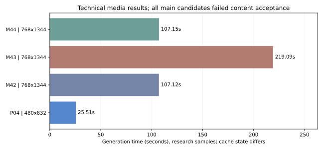

# Colab Media Lab：量化视频部署与成本实测

这是一份已脱敏的研究资料包，记录使用 Google Colab G4、RTX PRO 6000 Blackwell 96GB 运行 FastH3 V2 NVFP4 图生视频的部署过程、真实成本和失败结果。实验记录日期为 **2026-11-09（Asia/Shanghai）**。

**结论：量化视频推理已跑通，三个约 10 秒主片候选均未通过完整内容验收。研究轮次已结束，正式性能矩阵没有启动。**

本仓库适合作为后续文章的数据与部署材料。[Google AI Pro 每月 200 Colab CU 的官方权益已核验](docs/article-materials.md)，但本实验账户的具体入账来源未由用量接口证明。没有验证 Colab 生图或大规模批量、并发产能；首帧由 Colab 之外的独立图像生成工具制作。

## 已得到的数字

实测小时费率为 **10.05 CU/小时**。费率属于当次会话观察值，不是长期固定报价。

| 观察项 | 耗时 | 按费率估算的 CU | 口径 |
|---|---:|---:|---|
| 分配实例后，到首个生成请求开始 | 579.26 秒 | 1.617 | 一次研发恢复观察 |
| 首次请求，含首次内核编译和媒体校验 | 219.85 秒 | 0.614 | 已包含在下一行中 |
| 从观察到分配实例，到首条技术有效视频 | **799.11 秒** | **2.231** | 单次观察，非三次正式冷启动 |
| 480×832，124 帧，实际 5.167 秒 | **25.51 秒** | **0.071** | 仅生成部分，已有内核缓存 |
| 768×1344，243 帧，实际 10.125 秒 | **107.12–107.15 秒** | **约 0.299** | 两条已有缓存的研发记录，提示词/种子不同 |

768 档主片的框架显存峰值最高约 **42.43 GiB**，整卡显存采样最高约 **54 GiB**。已测规格没有出现显存不足；1080 档、15 秒、微调能力均未验证。

两个图生研发会话按观察时长估算合计 **17.260 CU**，已观察账户额度变动合计 **16.765 CU**，差约 **0.495 CU**，尚未完成最终计费对账。没有可核实现金单价，因此不换算人民币或美元。公开包不包含账户原始余额。

## 视频与验收结果

| 样本 | 技术检查 | 内容检查 | 主要问题 |
|---|---|---|---|
| [M42 视频](media/M42.mp4) / [抽帧](media/M42-contact.png) | 通过 | 未通过 | 出现中文字幕、浮动文字和漫画符号 |
| [M43 视频](media/M43.mp4) / [抽帧](media/M43-contact.png) | 通过 | 未通过 | 字幕仍在，镜头推近造成角色裁切，ASR 检出额外发声 |
| [M44 视频](media/M44.mp4) / [抽帧](media/M44-contact.png) | 通过 | 未通过 | 抽样画面无字幕、角色完整；开头已摆尾，台词未通过自动核验 |

ASR 是无目标提示的自动转写辅助证据，不是人工听审。M44 被转写为“限期凡，再思考”，不能据此单独断言实际发音；它的摆尾时机也不符合原定动作顺序。技术有效视频不等于通过脚本验收的视频。



## 材料导航

- [完整实测报告](docs/report.md)：耗时、资源、CU、失败结论与数据边界。
- [部署与恢复说明](docs/deployment.md)：CLI、Drive、环境隔离、补表和 FP4 内核问题。
- [后续文章素材与 200 CU 权益核验](docs/article-materials.md)：已核验权益、账户归因边界和可引用结论。
- [输入剧本与三版提示词](inputs/)：只改提示词，首帧不重新生成。
- [逐样本数据](data/observations.csv)、[阶段计时](data/stage-times.csv)、[资源采样](data/resources/)。
- [计费估算](data/research-session-costs.csv)、[结构化最终状态](data/results.json)。
- [脱敏范围与核验方式](docs/privacy.md)、[来源与许可说明](NOTICE.md)。

## 在本地查看，不分配云资源

```bash
# 可选：重画图表或检查媒体元数据时安装本次观测的 CPU 分析依赖
pip install -r requirements-analysis.txt
python scripts/validate_publication.py
python scripts/analyze.py
python -m unittest discover -s tests -v
```

分析与核验只处理本地文件，不调用云端 API 或申请 VM；依赖安装会访问软件源。仓库没有自动申请 GPU 的 CI 流程。公开部署副本另加了 GPU 分配显式开关，并采用较保守的示例预算；这些公开改动只做 CPU 检查，没有再次启动 GPU 验证。

发布时另运行了预算保护、真实 CPU 编码媒体验收和证据分卷还原检查，共 25 项本地测试通过。元数据与发布完整性核验命令为 `python scripts/validate_publication.py --media-metadata --strict-manifest`。重新生成图表会写入本地文件；如有意修改公开材料，应重新脱敏复核并生成发布清单，而不是把旧摘要视作新文件的证明。

历史研究中的无单轮 CU 上限策略不作为公开默认值。配置、依赖缓存和权重需要读者在自己的授权环境中准备，不能直接使用本实验的私人环境存档。

## 角色署名

角色为基于社区设定重新生成的 Q 版鲸鱼娘，视频为 AI 生成，非 DeepSeek 官方素材或官方背书。

作者：**YunYueSama**  
仓库：<https://github.com/YunYueSama/codex-deepseek-pet>

本实验修改了构图、饭碗道具和动作剧本。上游新增贡献的完整署名许可见 [licenses/community-character-LICENSE.txt](licenses/community-character-LICENSE.txt)，第三方参考边界见 [licenses/community-character-ASSET_LICENSE.md](licenses/community-character-ASSET_LICENSE.md)。没有复制上游原始社区参考图，也不附带模型权重。
